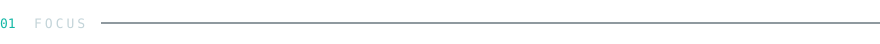
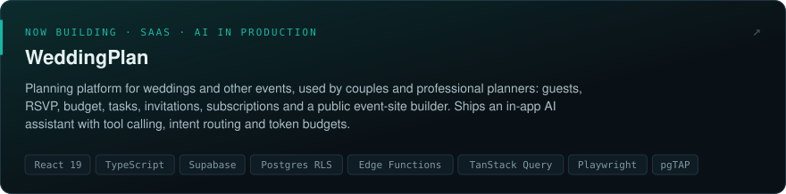
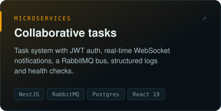
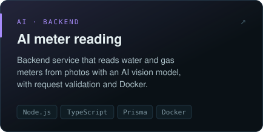

  

  
  
  

 

Backend-leaning full-stack developer at [Luby](https://www.luby.com.br/). I own features from the database to the screen: schema and access rules, APIs, and the React UI on top. **AI is one of my main focuses**, in how I build software and in what I ship.

<table>
  <tr>
    <td width="33%" valign="top">
      <b>AI-native engineering</b> 
      I run teams of coding agents (Claude, Codex) in parallel waves, each in its own git worktree, with automated review, CI gates and browser QA before anything merges.
    </td>
    <td width="33%" valign="top">
      <b>AI in the product</b> 
      LLM features in production: an in-app assistant with tool calling, intent routing, token budgets and usage limits, plus AI-written invitation drafts.
    </td>
    <td width="33%" valign="top">
      <b>Quality bar</b> 
      End-to-end type safety, automated tests at every layer (Vitest, Playwright, pgTAP) and error monitoring, so AI-generated work stays reviewable and safe.
    </td>
  </tr>
</table>

 

  

  
  

 

  

 

  

  <picture>
    <source media="(prefers-color-scheme: dark)" srcset="https://raw.githubusercontent.com/iLuiszin/iLuiszin/output/github-snake-dark.svg" />
    
  </picture>

